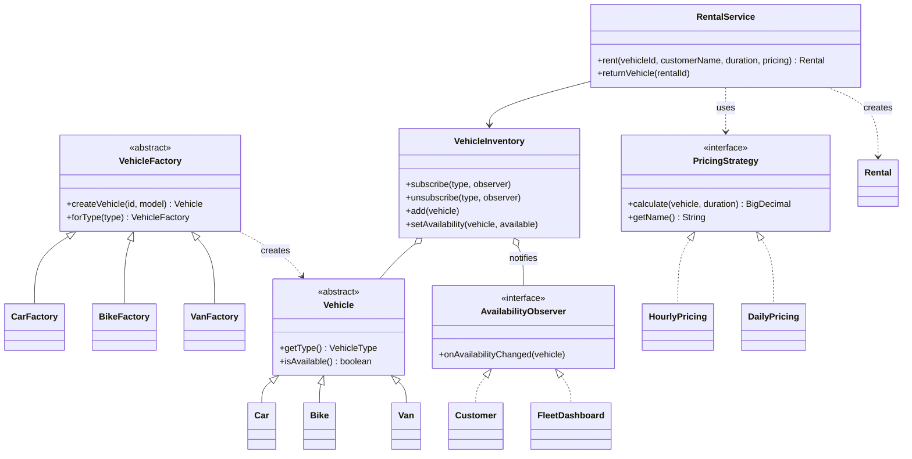

# Vehicle Rental Service

**Group:** SE-2535

## Team

1. Rustem Gazymbekov
2. Damir Tuleubaev

## About

A Java console application for renting cars, bikes and vans. Customers choose how a rental is priced and can ask to be notified when a vehicle of a given type becomes available.

## Progress: week 9 of 11

Three of the six required design patterns are implemented and working together.

| Pattern | Purpose in the project | Owner | Status |
| --- | --- | --- | --- |
| Factory Method | Create cars, bikes and vans with their rates (`factory`) | Rustem | Done |
| Strategy | Switch between hourly and daily pricing (`pricing`) | Rustem | Done |
| Observer | Notify customers and the dashboard about availability (`observer`, `VehicleInventory`) | Damir | Done |
| Builder | Assemble rental agreements with optional details | Damir | Planned |
| Decorator | Add extras to a rental, such as insurance or a child seat | Damir | Planned |
| Facade | Give the application one simple entry point for booking | Rustem | Planned |

### Remaining for week 11

- Implement Builder, Decorator and Facade and integrate them with the existing code
- Charge for the actual rental time on return (the cost currently uses the planned duration)
- Replace the scripted demo with an interactive console menu
- Write the PDF report with UML diagrams, code and screenshots

## How the patterns work together

`RentalService` takes a vehicle created by a factory, prices the rental with the chosen strategy and updates `VehicleInventory`, which notifies the observers.



## Run

Requires JDK 21 and Maven. In IntelliJ IDEA, open the project and run `Main`.

```bash
mvn test
```

```bash
mvn compile
```

```bash
java -cp target/classes com.vehiclerental.Main
```
