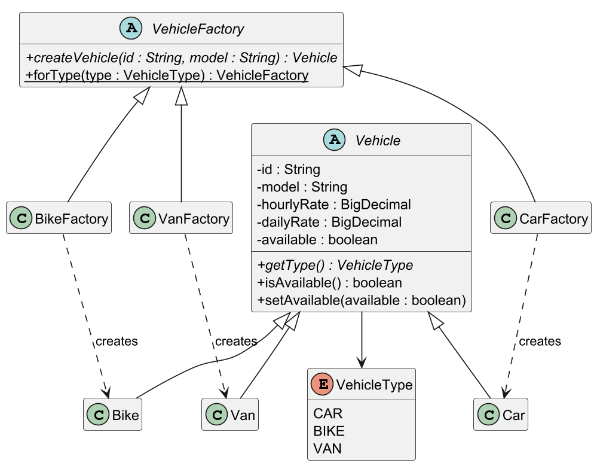
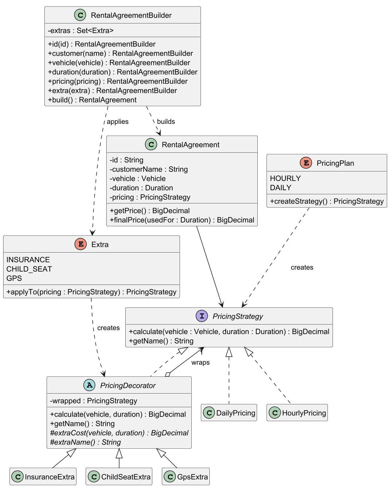
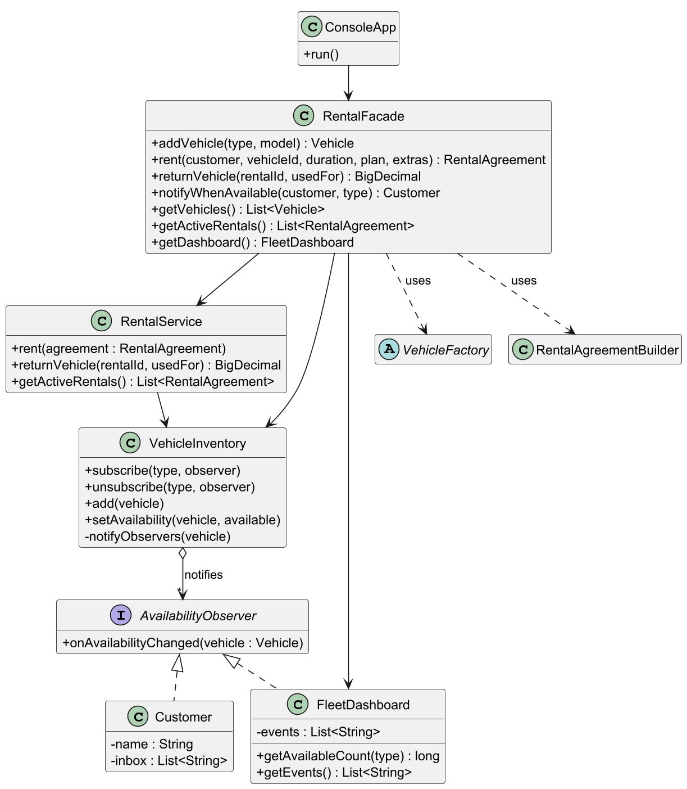
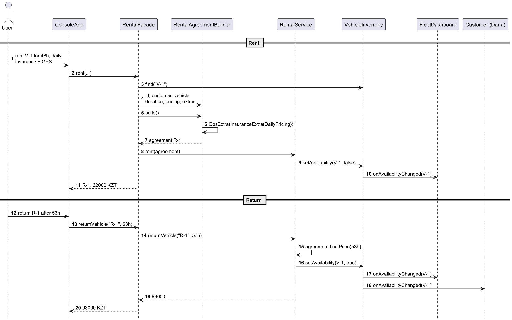
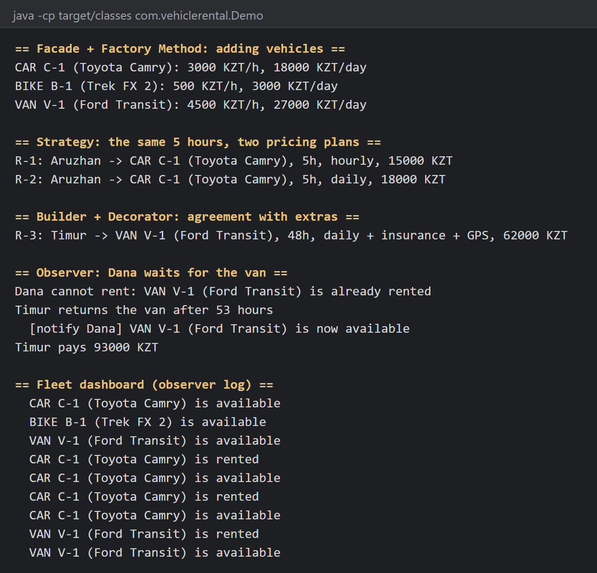
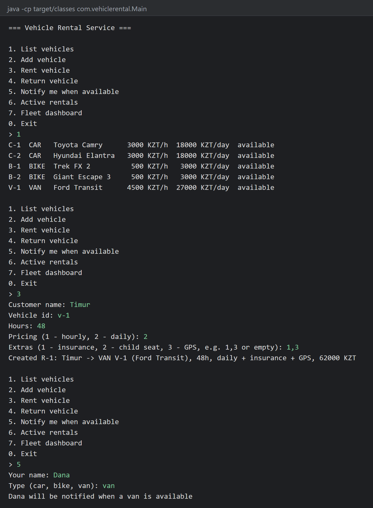
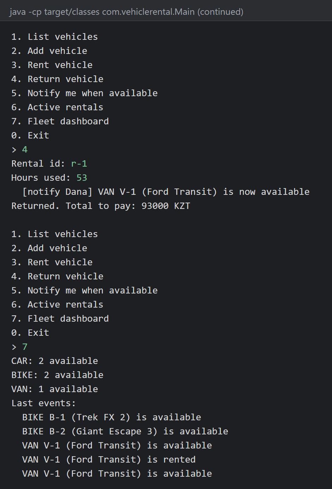

# Vehicle Rental Service

**Group:** SE-2535

## Team

1. Rustem Gazymbekov
2. Damir Tuleubaev

## About

A Java console application for renting cars, bikes and vans. A customer picks a vehicle, an hourly or daily pricing plan and optional extras (insurance, child seat, GPS). On return the price is calculated for the actual rental time, and customers waiting for that vehicle type get a notification.

## Design patterns

| Pattern | Purpose in the project | Package | Owner |
| --- | --- | --- | --- |
| Factory Method | Creates cars, bikes and vans with their rates | `factory` | Rustem |
| Strategy | Hourly or daily pricing, chosen for each rental | `pricing` | Rustem |
| Facade | `RentalFacade` is the single entry point for the console app | `facade` | Rustem |
| Observer | Customers and the dashboard react to availability changes | `observer`, `VehicleInventory` | Damir |
| Builder | `RentalAgreementBuilder` assembles and validates an agreement | `booking` | Damir |
| Decorator | Extras wrap the pricing strategy and add their cost | `extras` | Damir |

`ConsoleApp` talks only to `RentalFacade`. The facade creates vehicles through `VehicleFactory` and assembles agreements with `RentalAgreementBuilder`, which wraps the chosen `PricingStrategy` in one decorator per extra. `RentalService` marks vehicles as rented or available, and `VehicleInventory` notifies the observers.

## Pricing

| Vehicle | Per hour | Per day | Insurance per day |
| --- | --- | --- | --- |
| Car | 3000 KZT | 18000 KZT | 2000 KZT |
| Bike | 500 KZT | 3000 KZT | 500 KZT |
| Van | 4500 KZT | 27000 KZT | 3000 KZT |

A child seat costs 1500 KZT per rental and GPS 1000 KZT per day. Every started hour or day is charged. On return the customer pays for the longer of the booked and the used time.

## Run

Requires JDK 21 and Maven. In IntelliJ IDEA, open the project and run `GuiMain` for the desktop window (Swing), `Main` for the console menu or `Demo` for a short scenario that uses all six patterns. The window and the console menu both work only through `RentalFacade`.

```bash
mvn test
```

```bash
mvn compile
```

```bash
java -cp target/classes com.vehiclerental.Main
```

```bash
java -cp target/classes com.vehiclerental.Demo
```

```bash
java -cp target/classes com.vehiclerental.GuiMain
```

## Project structure

```
src/main/java/com/vehiclerental
  model      Vehicle, Car, Bike, Van, VehicleType
  factory    VehicleFactory, CarFactory, BikeFactory, VanFactory
  pricing    PricingStrategy, HourlyPricing, DailyPricing, PricingPlan
  extras     PricingDecorator, InsuranceExtra, ChildSeatExtra, GpsExtra, Extra
  booking    RentalAgreement, RentalAgreementBuilder
  observer   AvailabilityObserver, Customer, FleetDashboard
  service    VehicleInventory, RentalService
  facade     RentalFacade
  app        ConsoleApp, RentalPanel (Swing window), SampleFleet
```

## UML

The diagrams are made with PlantUML; the sources are in [docs/uml](docs/uml).

**Factory Method**



**Strategy, Decorator and Builder**



**Observer and Facade**



**Renting and returning a vehicle**



## Screenshots






